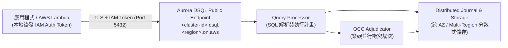

# Amazon Aurora DSQL 介紹

## 什麼是 Amazon Aurora DSQL？

**Amazon Aurora DSQL** 是 AWS 推出的 Serverless、分散式且相容 **PostgreSQL 16** 的關聯式資料庫服務。它最大的特色是把儲存與運算徹底分離並去中心化，讓關聯式資料庫也能像 DynamoDB 一樣具備「無伺服器、按用量計費、免預先開機或管理實例」的特性。

在傳統 Serverless 架構（例如 AWS Lambda）中，如果想使用關聯式資料庫，往往必須面臨幾個痛點：

- Lambda 必須放進 VPC 私有子網，若需要對外呼叫 API（例如第三方服務、發信、Turnstile 驗證），還得額外架設高昂的 NAT Gateway（或改用 EFS 掛載 SQLite，但一樣受限於 VPC 與單點檔案鎖）。
- 需要估算 DB Instance 規格或 Aurora Serverless ACU 下限，即使夜間完全沒有流量也仍有待機或管理負擔。
- 高併發 Lambda 同時冷啟動時，容易把傳統 PostgreSQL/MySQL 的 `max_connections` 打爆，往往還要再多一層 RDS Proxy。

Aurora DSQL 針對這些情境提供了原生解法：

- **無需 VPC / NAT Gateway**：提供公開端點，透過 **TLS + AWS IAM 驗證** 連線，Lambda 不需要掛載 VPC 就能安全存取資料庫。
- **真正 Serverless 與閒置零運算成本**：無需管理 EC2、RDS Instance 或配置連線池 Proxy，依實際請求與儲存空間計費。
- **Active-Active 高可用與自動擴展**：支援單 Region 跨可用區（AZ）以及跨 Region 的 Active-Active 架構，讀寫皆可水平擴展。
- **PostgreSQL 16 協定相容**：可使用標準 `pdo_pgsql`、`psql` 與常見 ORM（如 Laravel Eloquent）。

---

## 核心架構與運作原理

Aurora DSQL 與傳統單體式 PostgreSQL（或單主節點 Aurora）最大的差異在於「查詢處理」與「並行衝突裁決」完全分散化：

### 1. 樂觀並行控制（OCC, Optimistic Concurrency Control）

傳統 PostgreSQL 採用悲觀鎖（Row-level locks / `FOR UPDATE` / `FOR KEY SHARE`）：當兩個交易同時修改同一筆資料時，第二個交易會被鎖住等待第一個交易完成，這在分散式跨節點架構中容易造成嚴重延遲甚至死鎖。

Aurora DSQL 改用 **樂觀並行控制（OCC）**：

- 交易執行期間**不會鎖住資料列**，讀取與驗證皆基於分散式快照（Snapshot）。
- 交易準備提交（Commit）時，由 Adjudicator 檢查是否有其他交易同時修改了衝突的資料範圍（包含外鍵關聯檢查）。
- 若發生衝突，後提交的交易會**立即失敗並回滾**，回傳 PostgreSQL 標準的 Serialization Failure 錯誤碼 **`SQLSTATE 40001`**，不會讓連線卡住等待。
- 因此，應用程式端**必須對 `SQLSTATE 40001` 實作自動重試（Retry）機制**（例如 `DB::transaction($callback, $attempts)` 或驅動層自動重試）。

### 2. 固定交易隔離等級

Aurora DSQL 的交易隔離等級固定為 **`Repeatable Read`**（Snapshot Isolation），不支援切換為 `READ COMMITTED` 或 `SERIALIZABLE`。

---

## 驗證與連線特性

### 1. 無密碼 IAM 驗證

Aurora DSQL 不支援傳統帳號密碼或 `pg_hba.conf`，所有連線一律透過 AWS SigV4 簽署的 **短效 IAM Auth Token** 作為密碼進行驗證：

- **內建 `admin` 角色**：需要 IAM 權限 `dsql:DbConnectAdmin`。
- **一般自訂資料庫角色**：需要 IAM 權限 `dsql:DbConnect`。
- Token 可由 AWS SDK 在應用程式端**本地簽發**（不需發出額外遠端 API 請求），Lambda 只要掛載擁有對應權限的 Execution Role 即可。

### 2. 端點、Port 與 TLS

- **Endpoint 格式**：`<cluster-id>.dsql.<region>.on.aws`
- **Port**：固定 `5432`
- **Database 名稱**：每個 Cluster 固定只有單一資料庫 `postgres`
- **TLS 要求**：強制使用 TLS 連線（建議設定 `sslmode=verify-full` 並搭配系統根憑證 `sslrootcert=system`）

### 3. 連線存活上限與速率限制（重要！）

- **單一連線最長存活時間為 60 分鐘（1 小時）**：無論 Token 本身設定的有效期多長，Aurora DSQL 會在連線建立滿 60 分鐘時**主動強制中斷連線**。

> 重要❗❗❗
>
> IAM Auth Token 只在「建立新連線」當下驗證；但若使用長駐 Worker（如 Laravel Octane、常駐連線池），務必在接近 60 分鐘前主動回收或重建連線，以免請求撞上伺服器強斷。

- **新連線建立速率上限**：每個 Cluster 預設每秒最多接受約 **100 條新連線**（突發最高 1,000 條）。由於建立新連線還需經過 TLS 握手與 IAM 簽章，高流量環境建議適度重複使用連線（Connection Reuse），避免每個 HTTP 請求都重新握手。

---

## 與標準 PostgreSQL 的關鍵差異與限制

Aurora DSQL 雖然使用 PostgreSQL 16 語法，但為了保證分散式交易的一致性與效能，對 DDL 與部分 SQL 功能有嚴格限制：

| 項目                          | 標準 PostgreSQL                                           | Aurora DSQL 限制與對應做法                                                                                                    |
| :---------------------------- | :-------------------------------------------------------- | :---------------------------------------------------------------------------------------------------------------------------- |
| **DDL 交易規則**              | 單一交易可包含多條 DDL，也可與 DML 混用                   | **單一交易只能執行 1 條 DDL**，且**絕對不可混用 DDL 與 DML**                                                                  |
| **Savepoints**                | 支援 `SAVEPOINT` / 巢狀交易回滾                           | **不支援** Savepoints                                                                                                         |
| **Primary Key**               | 建表後可用 `ALTER TABLE` 補加或刪除                       | **必須在 `CREATE TABLE` 時宣告**，且建立後**無法刪除**                                                                        |
| **自動遞增主鍵**              | 支援 `SERIAL` / `BIGSERIAL`                               | **不支援 `SERIAL` 型別**；需使用 `BIGINT GENERATED BY DEFAULT AS IDENTITY (CACHE 1)`                                          |
| **新增欄位 (`ADD COLUMN`)**   | 可直接新增 `NOT NULL` 或帶 `DEFAULT` 的欄位               | 既有的表新增欄位**必須是 `NULLABLE` 且不可帶 `DEFAULT`**（須先新增 nullable 欄位，再另外設定 default）                        |
| **修改欄位 (`ALTER COLUMN`)** | 支援更改型別與 `SET NOT NULL`                             | **不可更改欄位型別，也不可改回 `NOT NULL`**（只能調整為 nullable、修改 default 等）                                           |
| **建立索引 (`CREATE INDEX`)** | 同步阻塞建立（或 `CONCURRENTLY`）                         | **必須使用非同步語法** `CREATE INDEX ASYNC` / `CREATE UNIQUE INDEX ASYNC`                                                     |
| **Foreign Key**               | 支援建表時與建表後新增                                    | 支援建表時宣告（含 Self-referencing）；**對既有表補加外鍵需使用 `NOT VALID`**（搭配 `ALTER TABLE ASYNC VALIDATE CONSTRAINT`） |
| **資料清空 (`TRUNCATE`)**     | 支援 `TRUNCATE TABLE`                                     | **不支援 `TRUNCATE`**，需改用 `DELETE FROM`                                                                                   |
| **系統隱藏欄位 `ctid`**       | 存在 `ctid` 可用於特定更新/刪除                           | **不支援 `ctid`**，更新與刪除須透過主鍵（如 `id`）                                                                            |
| **進階資料庫物件**            | 支援 Triggers、Stored Procedures、Temp Tables、Extensions | **皆不支援**（包含 PostGIS、pgvector 等擴充套件）；Collation 僅支援 **`C`**                                                   |
| **交易大小與時間上限**        | 無嚴格 3,000 列上限                                       | 單一交易最多修改 **3,000 筆資料列**（含 cascade）、**10 MiB** 資料量、最長 **5 分鐘**                                         |

> Aurora DSQL 已支援 `JSON` / `JSONB` 型別與常見 JSON 函式，但 `JSONB` 欄位不能作為主鍵或二級索引鍵（Secondary Index Key）。此外，若專案同時在本地用 SQLite 測試或需要跨資料庫相容性，單純用程式端序列化 JSON 的欄位改以 `text` 儲存往往更單純。

---

## 與 RDS / Aurora Serverless v2 / SQLite on EFS 比較

| 比較項目              | Amazon Aurora DSQL                                                               | Aurora Serverless v2 / RDS                                                     | SQLite on EFS (Lambda)                               |
| :-------------------- | :------------------------------------------------------------------------------- | :----------------------------------------------------------------------------- | :--------------------------------------------------- |
| **VPC / NAT Gateway** | **不需要**（Public Endpoint + IAM）                                              | **需要**（通常需 Private Subnet + NAT / Proxy）                                | **需要**（掛載 EFS 必須進 VPC）                      |
| **閒置運算成本**      | **零（Scale to Zero）**                                                          | 最低 ACU（如 0.5 ACU）或持續計費（v2 雖支援 0 ACU 但冷啟動恢復需時間）         | EFS 本身按容量計費，但需負擔 VPC / NAT 成本          |
| **連線與併發瓶頸**    | IAM Token + 水平擴展，無單機連線池上限問題                                       | 需評估 `max_connections`，Lambda 通常需搭 RDS Proxy                            | 受單一檔案寫入鎖（Write Lock）限制，高併發寫入易鎖死 |
| **驗證方式**          | **純 IAM Token**（無靜態密碼）                                                   | 帳號密碼（Secrets Manager）或 IAM Auth                                         | 檔案系統 POSIX UID/GID 權限                          |
| **SQL 相容性**        | PostgreSQL 16 子集（有 DDL/OCC 限制）                                            | 完整 PostgreSQL / MySQL 相容                                                   | SQLite 語法（非標準 Client-Server SQL）              |
| **適用場景**          | **Lambda / Serverless 微服務、無 VPC 偏好、中高併發且可配合 OCC 限制的新舊專案** | 需要完整 PG 擴充套件（pgvector/PostGIS）、複雜 Stored Procedure 或重度現有系統 | 極低併發、個人小工具或既有單機原型                   |

---

## 延伸閱讀

- [Laravel 搬移至 AWS Aurora DSQL 實戰與踩坑筆記](/laravel/migrate-laravel-to-aurora-dsql)
- [AWS 官方文件：What is Amazon Aurora DSQL?](https://docs.aws.amazon.com/dsql/latest/userguide/what-is-dsql.html)
- [Bref 官方文件：Aurora DSQL](https://bref.sh/docs/environment/database-dsql)
